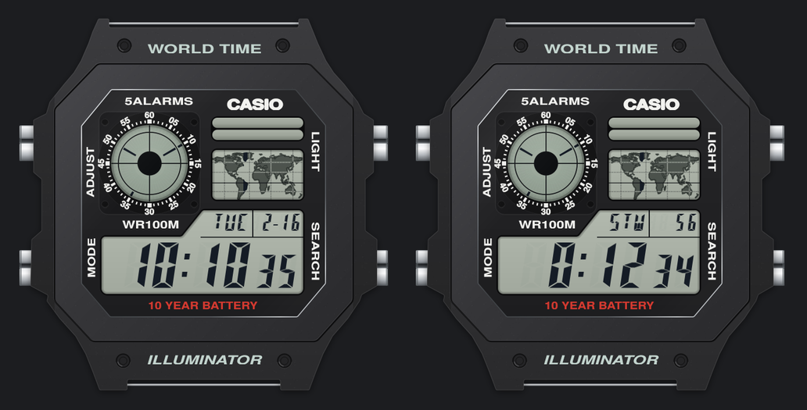

# Casio Royale — the AE-1200 stopwatch for Omarchy



A bar widget for the Omarchy shell that opens a working replica of the Casio
AE-1200WH-1A, module 3299, and runs its stopwatch. The stopwatch counts in
1/100 s up to 23:59'59"99 and supports split times and 1st/2nd-place times.

The face is drawn from measurements of a straight-on product photo, scanned
row by row for the case silhouette. Positions are measured on the photo
directly, and the digits were checked by overlaying the render on it.
`Lcd.js` explains the coordinate system. The face includes:

- the case head (no strap): lugs with their spring bars, long chamfers,
  hexagonal guards and four decorative screws
- the groove around the bezel, and the black plate with its polished edge
- the printing: WORLD TIME, 5ALARMS, CASIO, WR100M, ADJUST, LIGHT, MODE,
  SEARCH, 10 YEAR BATTERY and ILLUMINATOR
- the round digital dial: a 60-second ring with tilted numerals, and
  segment hands that always show the current home time, as the manual says
- the world map, with the home time zone dark (taken from the system UTC
  offset), plus the dotted grid and the two indicator strips
- the day/date row (`TUE 2-16`) and the big italic H:MM digits with smaller
  seconds. The segments are cut on the diagonal, and the verticals are
  heavier than the horizontals, as on the watch.

## Install

```bash
omarchy plugin add https://github.com/tiago-vello/omarchy-casio-royale
omarchy bar put tiago.ae1200 --section right --index 0
```

For development, clone the repository anywhere and symlink it instead:
`ln -s "$PWD" ~/.config/omarchy/plugins/tiago.ae1200`.

The popup's card is see-through around the watch. For the desktop behind it
to be blurred, Hyprland needs a blur rule for the shell's popup layer, for
example in `~/.config/hypr/looknfeel.lua`:

```lua
hl.layer_rule({
  match = { namespace = "^omarchy-keyboard-panel$" },
  blur = true,
  ignore_alpha = 0.2,
})
```

Other shell popups draw opaque cards, so the rule doesn't change them.
Without the rule the area around the watch is see-through but not blurred;
set `backdrop` to `1` for a solid card.

## Use

| Input                        | Action                                     |
|------------------------------|--------------------------------------------|
| Bar: left click              | open / close the watch                     |
| Bar: right click             | start / stop the stopwatch                 |
| Bar: middle click            | split / clear the stopwatch                |
| Click a pusher on the watch  | press it                                   |
| `a` / Enter                  | **A** (ADJUST)                             |
| `b`                          | **B** (LIGHT)                              |
| `c` / `m`                    | **C** (MODE)                               |
| `d` / Space                  | **D** (SEARCH)                             |
| hold **C** 2 s, or `u`       | turn the button tone off / on (MUTE)       |

The pushers behave as module 3299 describes. MODE switches between
Stopwatch (`STW`) and Timekeeping.

- **Stopwatch:** D starts and stops it. A splits while running (the display
  freezes, `SPL` shows, and the count keeps running underneath), releases a
  held split, and clears once stopped. The display shows `H:MM` big, the
  seconds smaller, and 1/100 s in the date window.
  - **Elapsed time:** D start → D stop → D restart → D stop → A clear
  - **Split time:** D start → A split → A release → D stop → A clear
  - **Two finishes:** D start → A (1st finishes) → D (2nd finishes) →
    A (shows 2nd) → A clear
- **Timekeeping:** shows the day, date and time. A shows the home city code
  (`RIO`, `TYO`, … from the city table) and `T-1` for a second.
- **B:** lights the LED for 1.5 s.

Every press beeps (`beep.wav`, a ~4 kHz piezo chirp) unless the tone is muted.

State is saved to `~/.local/state/omarchy-ae1200-stopwatch.json` as
wall-clock timestamps, so a running stopwatch keeps counting through a shell
restart.

## IPC

```bash
omarchy-shell tiago.ae1200.stopwatch startStop
omarchy-shell tiago.ae1200.stopwatch splitReset
omarchy-shell tiago.ae1200.stopwatch press A|B|C|D
omarchy-shell tiago.ae1200.stopwatch mute
omarchy-shell tiago.ae1200.stopwatch status   # e.g. "running split 0:01'02"35"
omarchy-shell tiago.ae1200 toggle             # open/close the watch
```

## Settings (`shell.json` bar entry)

- `scale`: size of the watch (default `1`, about 390 × 396 px).
- `backdrop`: how much of the popup colour covers the blurred desktop around
  the watch, `0` (clear) to `1` (solid). Default `0.4`.

## Files

- `Model.js` — stopwatch state machine (pure; `node tests/model.test.js Model.js`)
- `StopwatchStore.qml` — singleton: state, the pushers' logic per mode, beep, persistence, IPC
- `Panel.qml` — the bar widget and its popup. The popup's anchor is pinned
  when it opens, so the watch stays put while the bar label grows or shrinks.
- `WatchFace.qml` — the watch: a pure view, so it renders without the shell
- `CaseArt.qml`, `LcdWindow.qml`, `DialLcd.qml`, `MapLcd.qml` — case and LCD windows
- `SevenSegment.qml`, `AlphaSegment.qml`, `SegBlock.qml`, `Seg.js` — LCD segments
- `Lcd.js` — measured geometry, palette, city codes
- `MapData.js` — coastlines from Natural Earth 1:110m (public domain), projected for the map window

## Known guesses

- **MUTE:** where the indicator sits is a guess (the right end of the upper
  indicator strip). The manual names it but does not show its place on this
  module.
- **LED light:** its colour and spread are approximate.
- **Mode coverage:** only two of the watch's five modes are here. World
  Time, Alarm and Countdown Timer are not.
